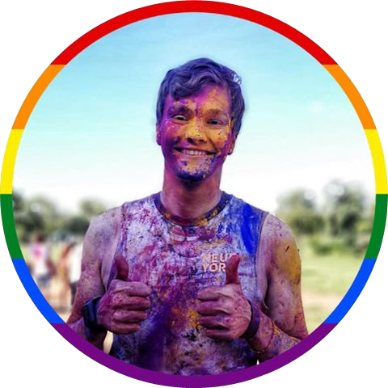

  
  
  

  <h1>Hey, I'm Graeme 👋</h1>

  
<b>I build websites that earn their keep.</b> 
  Founder of <a href="https://thedesignhammock.co.za" target="_blank">The Design Hammock</a>, a one-person web studio in Pretoria, South Africa 🇿🇦

  
  
  

 

### 🛠️ What I'm doing in 2027

- 🚀 **Agency sites** on TanStack Start + React, typed end to end and tested before they ship
- 🛍️ **Shopify themes** in Liquid for stores that need to sell, not just sit there
- 🎨 **Wix builds** for clients who want to edit their own site without phoning me
- 🩹 **WordPress care and rescue** for sites that were someone else's problem until now
- 🤖 Pairing with AI agents daily, with tests and a healthy dose of scepticism

### 🧬 Before the agency

I came up through **bioinformatics research** at the University of Pretoria, working on pharmacogenomics: the genetics of why people respond differently to the same drug. The habit stuck. I still treat a website like an experiment: form a hypothesis, measure it, change it.

### 🧰 Daily drivers

**Web** 

**Platforms** 

**Quality and tooling** 

<b>From the research days</b>

 

 

  
    
  Need a site that pulls its weight? <a href="https://thedesignhammock.co.za" target="_blank">Let's talk.</a>

