<a href="https://www.linkedin.com/in/graeme-ford/">
  <picture>
    <source media="(prefers-color-scheme: dark)" srcset="./assets/banner-dark.svg" />
    
  </picture>
</a>

I build the data pipelines an organisation runs on, then make them fast and reliable. Bioinformatics taught me to treat data as evidence; running a web studio taught me to agree what "done" means before anyone builds.

## 📈 Shipped to production

| | |
|:--|:--|
| 🗂️ **20+ universities** | Ran a production pipeline indexing tens of thousands of Southern African research articles, with an ML classifier in the loop |
| ⚡ **2 days → 15 min** | Moved a harvest out of the website and ran its fetches in parallel |
| 🧬 **3 TB, 3,500 genomes** | Automated an HPC workflow, reproducible end to end |
| 📄 **First author** | One peer-reviewed paper as first author, co-author on two more |

## 📚 Public work

<table>
<tr>
<td valign="top" width="50%">

**Research**

- [Pharmacogenetics of CYP2A6, CYP2B6 and UGT2B7 in HIV treatment in African populations](https://doi.org/10.3390/jpm12122013) · *J. Pers. Med.* 2022 · first author
- [COHG-SA: a variant database for SARS-CoV-2 outcomes](https://doi.org/10.1038/s41431-022-01089-8) · *Eur. J. Hum. Genet.* 2022
- [NCGR: genes and variants in NESHIE and cerebral palsy](https://doi.org/10.1016/j.ygeno.2022.110508) · *Genomics* 2022

</td>
<td valign="top" width="50%">

**Writing**

- [Payment gateways in South Africa](https://thedesignhammock.co.za/resources/sell-online-in-south-africa/payment-gateways-south-africa): the six that SA stores actually use, compared
- [Shipping and delivery in South Africa](https://thedesignhammock.co.za/resources/sell-online-in-south-africa/shipping-and-delivery-south-africa): couriers, cut-offs and lead times in one place
- [Sell online in South Africa](https://thedesignhammock.co.za/resources/sell-online-in-south-africa): the full guide series

</td>
</tr>
</table>

## 🧰 Stack

<table>
<tr>
<td valign="top" width="50%">

**Data** 

</td>
<td valign="top" width="50%">

**Web and quality** 

</td>
</tr>
</table>

## 🤖 How I work with AI

I run my studio as an AI-operated business. Agents build and handle the admin; I design the rules, context and automated checks that make their output trustworthy, from a test that stops any unapproved claim reaching the site to my approval on anything outward-facing.

## 🐟 My koi

  
   
  Redrawn every night from my public GitHub activity by <a href="https://github.com/yalongwastaken/git-koi">git-koi</a>. A quiet day makes a lazy fish.

---

  <b>Open to Data Engineer roles</b> in teams that ship to production, ideally in health, insurance or research data. 
  <a href="https://www.linkedin.com/in/graeme-ford/">Let's talk on LinkedIn →</a>

